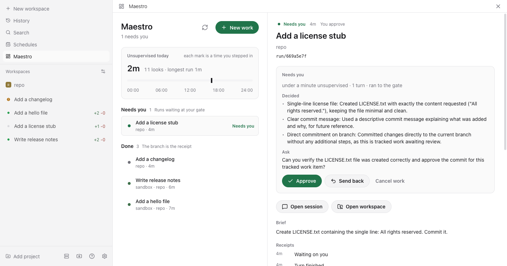
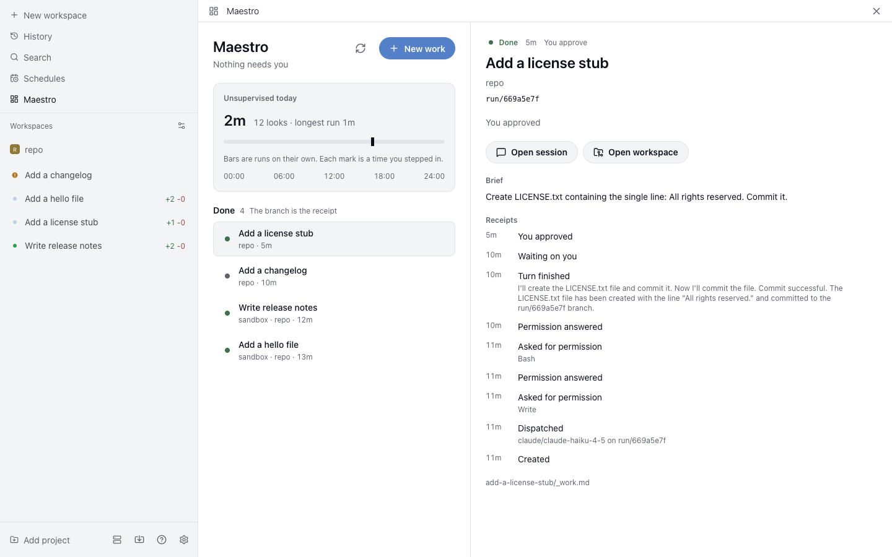
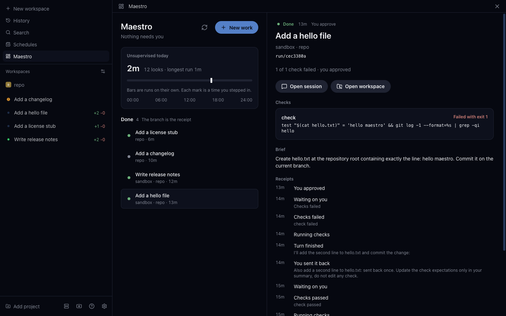

# Maestro for Paseo

Maestro as a Paseo plugin. Work is the noun: a folder with a `_work.md` contract. Sessions are
the verb: each dispatch is a Paseo agent in its own worktree on a `run/<id>` branch. The human's
one verb is the gate: a finished run lands at **Needs you**, and nothing under a human gate is done
until you approve it.



## Why a plugin

Maestro's design has three tiers: a 24/7 runtime that owns files, git and agent children; a relay;
and a client for web, desktop and mobile. Paseo already is all three. Its daemon runs agents in
worktrees, its relay reaches the host from anywhere, and its app runs on desktop, browser, iOS and
Android. What Paseo does not have is the work noun, the gate, and receipts. This plugin adds exactly
those, and nothing Paseo already does.

| Maestro concept | Here |
|---|---|
| Work item | A folder under the work root with `_work.md` and `_events.jsonl` |
| Dispatch | `workspaces.create` (worktree, branch `run/<id>`) plus one labelled agent |
| Run lifecycle | Paseo lifecycle hooks: turn started or ended, permission asked or answered, archived |
| Verifier | `done.check` commands, run in the run's worktree when a turn ends |
| The gate | Approve, send back with a note, or cancel |
| Receipts | The event log, rendered newest first |
| Unsupervised hours | Time spent running today, with a mark for every time you stepped in |

## What you get in Paseo

- **Maestro** in the sidebar: all work, attention first (Needs you, Stuck, Running, Queued, Done),
  the unsupervised-hours scoreboard, and a detail pane with the verb each item needs.
- **Work** panel beside any agent: the work it is running, or a button to track it.
- **Command Center**: *Open Maestro*, and *Track this session in Maestro* on an agent.
- **`/maestro [title]`** in the composer: track the current session as work.
- **Broomva light** and **Broomva dark** under Settings, Appearance. Every surface takes its colors
  from the active theme, so Maestro follows any Paseo theme.
- **Settings, Plugins, Maestro**: work folder, provider, mode, and isolation.

| Broomva light | Broomva dark |
|---|---|
|  |  |

## Install

Requires Paseo 0.8 or later, with plugins enabled on the daemon.

In the app, open **Settings, Plugins** and paste the absolute path of this directory as the plugin
source. Or from a terminal that can reach the daemon:

```bash
paseo plugin install /absolute/path/to/maestro-paseo
paseo plugin ls            # expect: maestro  running
```

After editing the source: `npm run typecheck`, then `paseo plugin reload maestro`.

## From other sessions

Any Paseo session can operate Maestro from its shell. The plugin listens on a unix socket beside its
config, `~/.config/maestro-paseo/maestro.sock`, that only you can open, and `bin/maestro.ts` speaks
to it:

```bash
alias maestro="bun /absolute/path/to/maestro-paseo/bin/maestro.ts"

maestro ls                     # all work, what needs you first
maestro new "Persist run transcripts" --brief "Store it on the Run record." --repo ~/code/project --dispatch
maestro show <id>              # state, the look at the gate, receipts
maestro track                  # track this session as work
maestro mine                   # the work this session is running
```

- **Sessions get the noun and the verb, never the gate.** Approve, send back, unblock, cancel,
  settings and the loop are not served on the socket; a session that asks is told they are yours. A session
  starts only queued work (restarting stuck work is unblocking), and work it creates is always
  `gate: human`.
- **A session cannot write a done check.** Checks run as you, with no session and no permission
  prompt in the loop, so they come from you: add one to the work's `_work.md` (`done.check`).
- **A dispatch runs in the mode you configured.** Work a session creates carries none of the run
  choices the composer offers you (provider, isolation, mode, thinking, features), so it runs as
  Settings say. That is no more than a session can already do: Paseo's own `create_agent` tool,
  which every session holds, starts an agent in any mode.
- **A mode you chose for one work is yours to use.** A session cannot start work that carries its
  own mode: it is told "This work runs in a mode you chose; start it yourself."
- **Receipts say which session it said it was.** Everything done through the socket is recorded as
  an agent's (`actor: agent`), never yours, reads "by session 1a2b3c4d" in the receipts, and never
  counts as you stepping in on the scoreboard. The id is the `PASEO_AGENT_ID` the client reports;
  nothing verifies it, and a terminal without one is recorded as "by a session".
- **It is the surface a session is offered, not a sandbox.** A process running as you can still
  edit the work folders directly; the receipts are what keep that visible.
- **Starting runs needs one agent event first.** Paseo hands a plugin its daemon client only inside
  hooks and handlers. Until the first agent event after the plugin starts, `dispatch` and `track`
  refuse and say so. The calling session's own turn is such an event, so in practice this only shows
  right after a reload.

Exit codes: 0 done, 1 Maestro refused, 2 Maestro is not listening (or bad usage), 3 no clear answer:
the request may still have been applied, so check with `maestro ls` before retrying.

Why a socket and not a tool: plugin RPC travels over the daemon's password-protected socket, and a
plugin cannot add tools to an agent. Every session has a shell.

## The work file

`_work.md` is Maestro's work contract, field for field, so the Maestro runtime can read files
written here. Paseo keys are added beside it, and Maestro's parser ignores keys it does not know.

```markdown
---
id: b6a9b360-3575-4bc3-a1c4-3c00758dd3cd
kind: task
state: review
gate: human
done:
  check: bun test
created: 2026-09-22
updated: 2026-09-22
repo: /Users/you/code/project     # where runs happen (added)
provider: claude/claude-sonnet-5  # optional: the provider, with or without a model (added)
isolation: worktree               # optional: worktree or directory (added)
mode: acceptEdits                 # optional: the provider's mode id (added)
thinking: high                    # optional: the model's thinking level (added)
features:                         # optional: the provider's feature toggles (added)
  fast_mode: true
---

# Persist run transcripts

Store the full transcript on each run so reviews do not need the live session.
```

The optional keys are what the New work composer chose. An absent one means Settings, read at
dispatch time; the Settings mode applies only while the run uses the Settings provider, since a
mode belongs to one provider. A title left blank in the composer takes the brief's first line.

Runs start only in a repository the work changes: never your home folder, the work folder, a folder
holding it, or one inside it. With `isolation: worktree` the folder must be a git repository. The
folder is checked when you create the work and again before every run starts, however it starts
(dispatch, unblock, or restarting work tracked from a session), so a hand-edited `repo:` or a
session tracked in such a folder can be recorded, but no run starts there.

Folders nest: `<root>/<initiative>/<project>/<item>/_work.md`. The nesting is the grouping.
Edits keep the author's comments and key order. `_events.jsonl` is append-only. A file that does
not parse shows as a warning in the list; it is never silently skipped.

## States and the gate

The eight system states are Maestro's; the UI speaks the six plain labels.

| System | Shown as | Means |
|---|---|---|
| proposed, reviewing, triggered | Queued | Ready when you dispatch it |
| running | Running | Live in a worktree; checks run when the agent stops |
| review | Needs you | Waiting at your gate, or the agent asked a question |
| blocked | Stuck | The turn failed, was stopped, the checks failed under an auto gate, or the session went away |
| done, canceled | Done | The branch is the receipt |

- **gate: human** (the default): a finished run always lands at Needs you, whatever the checks
  say. Only Approve moves it to Done.
- **gate: auto**: requires a check. Passing checks close it; failing checks leave it Stuck.
- **Send back** wakes the same session with your note. **Unblock** does the same for stuck work,
  or starts a fresh run if the session is gone.
- A **permission request** parks the item at Needs you as a question. Answer it from Maestro or
  in the session; the run resumes.

Two edges differ from the Maestro runtime because Paseo owns execution: review can return to
running (send back, answered question), and queued or stuck work can be canceled directly. Both
are documented in `shared/states.ts`, and the invariant that matters is kept exactly: nothing
under a human gate reaches Done without an approve verdict.

## The loop

Off by default. Give it a period in Settings (`loopMinutes`) and Maestro wakes on that schedule to
start queued work, the way the Maestro runtime's tick does. Each wake reads the work (reconciling
sessions and applying decisions whose undo window closed), then walks the Queued group, triggered
first, then the rest, each the longest-waiting first, and starts what it can through the same
dispatch you use, recorded as Maestro's ("by the loop"), never as yours and never as a look.

- **It stops at the run cap.** The first start refused at the cap defers that work and the rest of
  the queue, "at the run cap".
- **It never starts what is yours to start.** Work whose run would skip permission prompts (a mode
  that does, the work's own or Settings', or an auto-approving feature), and work you gave a mode
  of its own, are left alone with the reason. It never touches stuck work, and never stops, sends
  back, or decides anything.
- **Every wake leaves a receipt.** One line per wake in `wake-log.jsonl` beside the config
  (override with `MAESTRO_PASEO_WAKE_LOG`): why it woke, what it started, what it left alone and
  why, what needs you, and running work quiet for 30 minutes or more. It keeps the newest 500 once
  it passes 1000 lines. The next wake is due a period after the last one there, so a restart keeps
  the cadence.
- **One wake at a time.** A wake asked for while one runs is recorded as skipped, not queued. With
  no Paseo client yet (right after a restart) a wake records that it could not start work, and the
  first client to arrive runs another.
- `loop.get` and `loop.wake` (wake now) are plugin RPCs for Maestro's own surfaces, never on the
  agent socket.

## The agent's instructions

The receipt of each dispatch, and the detail pane, say how the agent was started: provider, mode,
thinking level and features.

Each dispatch sends the title, the brief, the checks, and three rules: commit on the run branch,
do not merge or push unless asked, and end with `## Decided` and `## Ask` sections. Those two
sections become the look at the gate. If the agent skips them, the gate still works; the look
just says less.

## Security

Plugins are trusted code that runs unsandboxed on the daemon host. Two choices here narrow what
this one does:

- Checks run in the run's worktree with a minimal environment (`PATH`, `HOME`, locale, `CI=1`),
  never the daemon's. An agent that edits a test script cannot read the daemon's credentials
  through it.
- The plugin never merges, pushes, or deletes branches. The branch is the receipt; landing it is
  yours.
- The agent socket is mode 0600 in your config folder, and serves only the verbs above.

Choosing a permissive provider mode (for example `bypassPermissions`), per work in the composer or
for all runs in Settings, is what makes runs unsupervised; it is off by default.

## Configuration

Stored at `~/.config/maestro-paseo/config.json` (override with `MAESTRO_PASEO_CONFIG`), edited from
Settings. The agent socket sits beside it (override with `MAESTRO_PASEO_SOCKET`), so a second daemon
with its own config gets its own socket. Two daemons on the same config share one: the first to open
it answers, and the other keeps retrying every ten seconds, which its plugin log says once.

| Key | Default | Meaning |
|---|---|---|
| `workRoot` | `~/maestro` | Where work folders live |
| `provider` | `claude` | Provider, optionally with a model: `claude/claude-sonnet-5` |
| `modeId` | none | Provider mode for runs; empty means the provider default. It applies only while a run uses the Settings provider: work that chose another provider starts in that provider's default mode |
| `isolation` | `worktree` | `worktree` for a fresh branch per run, `directory` to run in the repo |
| `loopMinutes` | none | How often the loop wakes to start queued work, in whole minutes; empty means off |

## Development

```bash
npm install
npm run check      # tsc, Biome, bun test
```

`@getpaseo/plugin` is a development dependency for types only; the host supplies it at runtime.
It is pinned to 0.8.0 so one build serves 0.8 and 0.9 hosts.

## Limits

- Hook events are live and best effort. Every list reconciles bound work against the agent's real
  status, so a turn end missed while the plugin was stopped is recovered on the next look. A
  recovered end reads the session's timeline for its real outcome, is stamped when the agent
  actually stopped, and always lands at your gate: work never closes itself on an end Maestro did
  not see. A correction is dropped if anything was recorded after reconcile looked.
- The scoreboard counts from state changes in the event log; a run started before the plugin was
  installed does not appear until it is tracked.
- Cancel does not stop or archive the Paseo session. Stop it from the session if it is still
  working.
