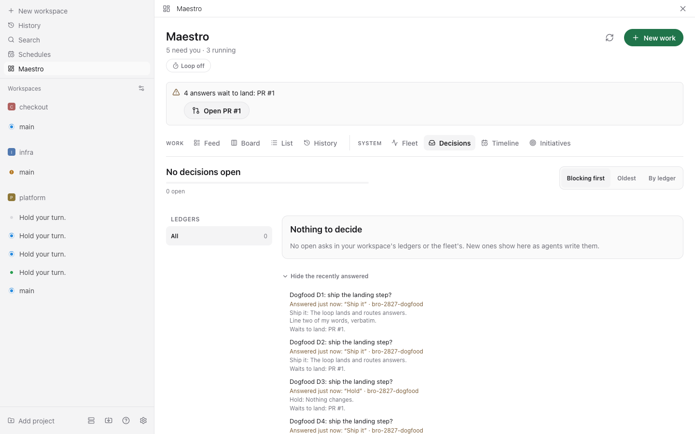
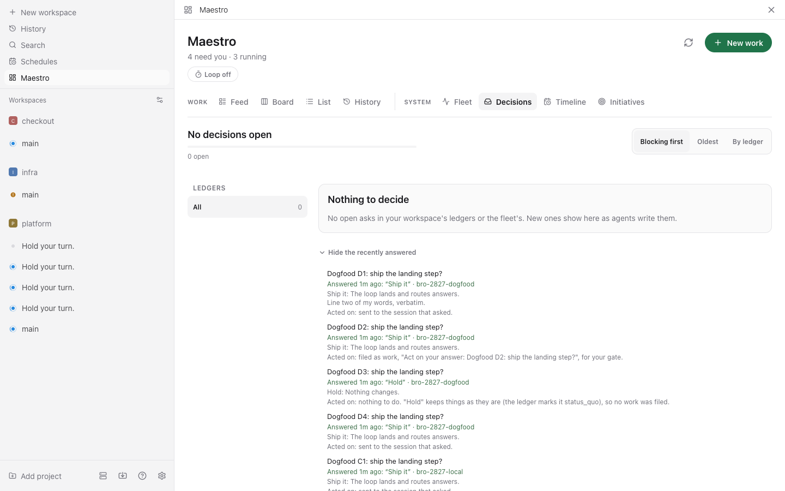
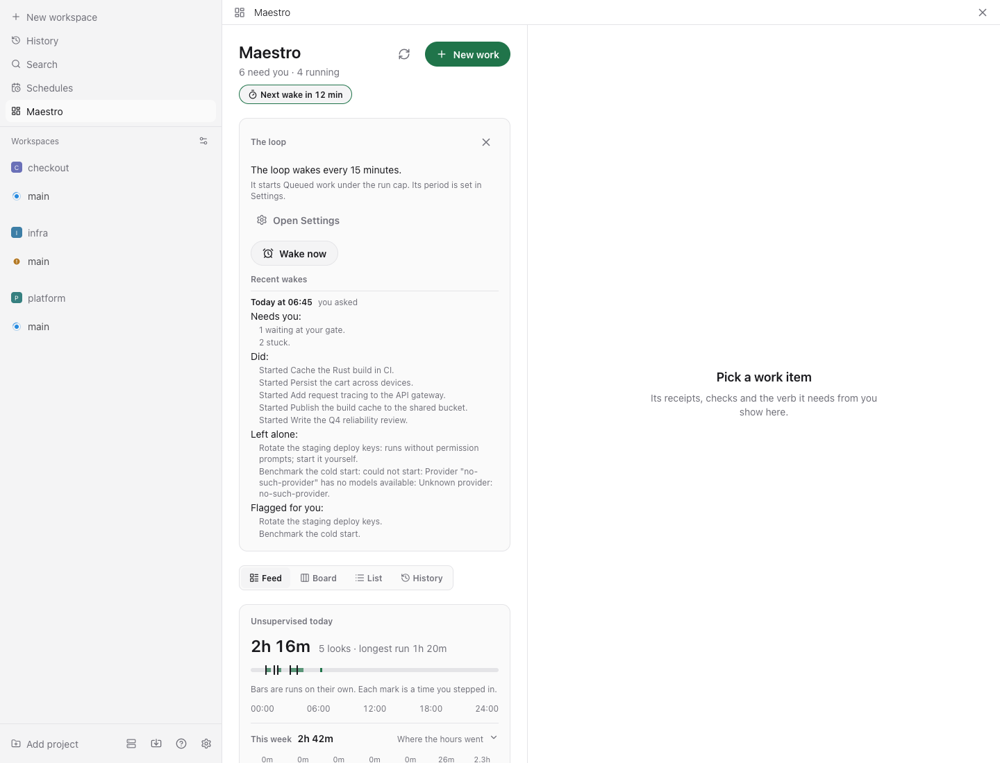
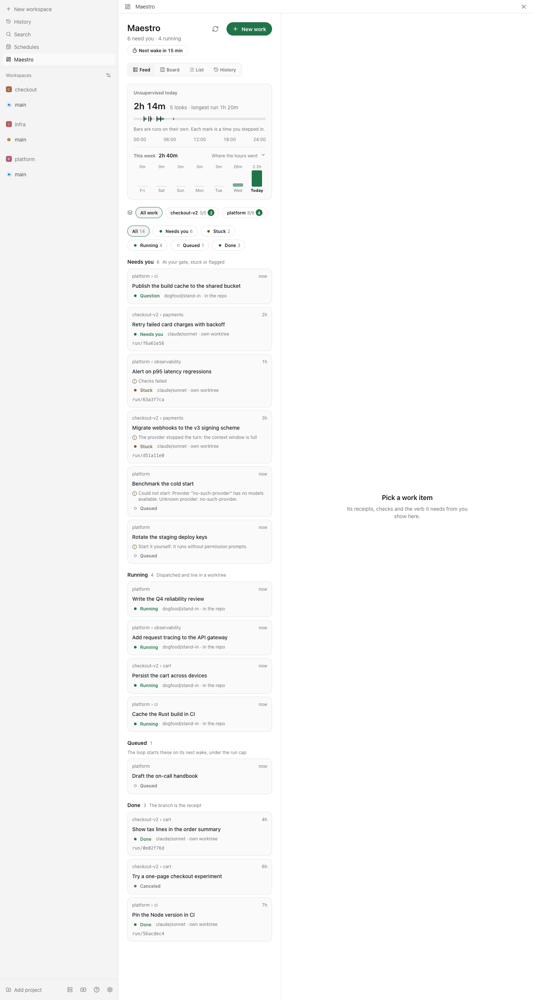
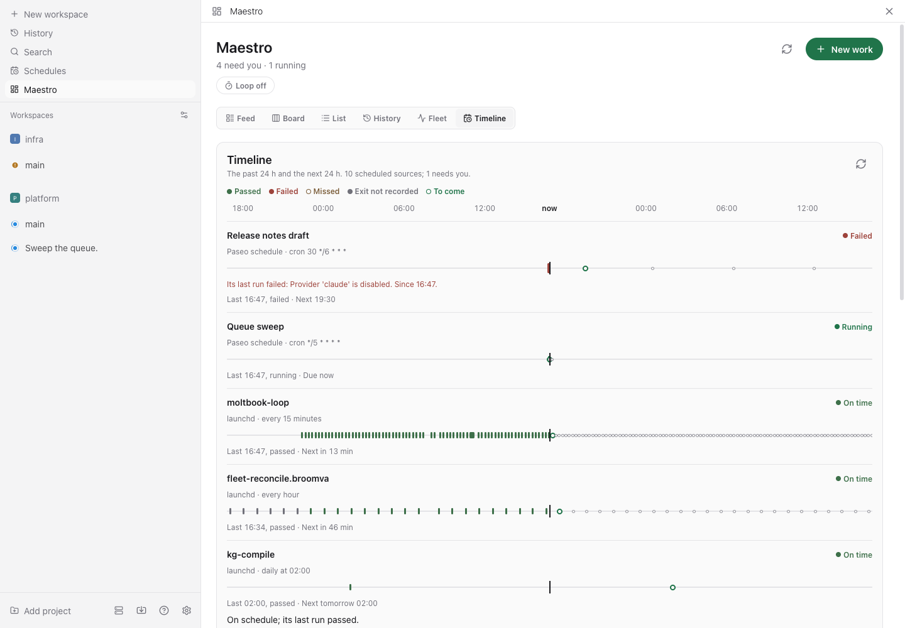
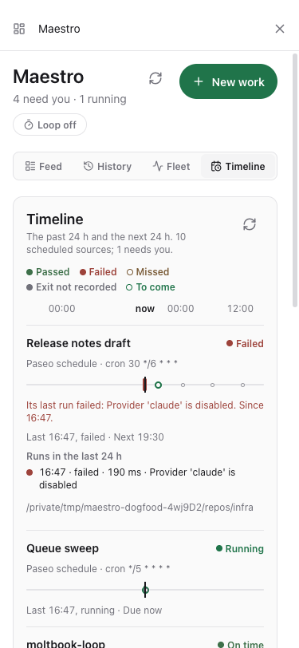
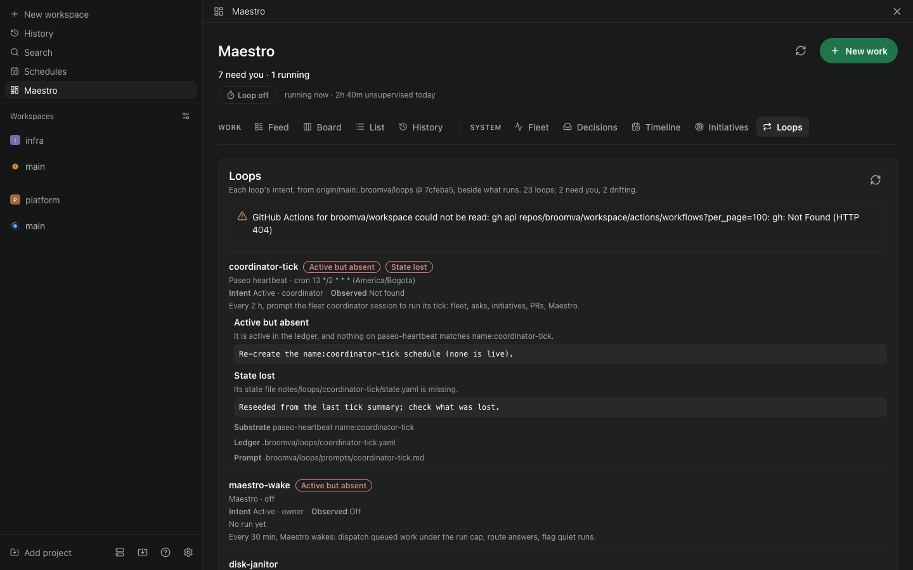

# Maestro for Paseo

Maestro as a Paseo plugin. Work is the noun: a folder with a `_work.md` contract. Sessions are
the verb: each dispatch is a Paseo agent in its own worktree on a `run/<id>` branch. The human's
one verb is the gate: a finished run lands at **Needs you**, and nothing under a human gate is done
until you approve it.


## Why a plugin

Maestro's design has three tiers: a 24/7 runtime that owns files, git and agent children; a relay;
and a client for web, desktop and mobile. Paseo already is all three. Its daemon runs agents in
worktrees, its relay reaches the host from anywhere, and its app runs on desktop, browser, iOS and
Android. What Paseo does not have is the work noun, the gate, and receipts. This plugin adds exactly
those, and nothing Paseo already does.

| Maestro concept | Here |
|---|---|
| Work item | A folder under the work root with `_work.md` and `_events.jsonl` |
| Dispatch | `workspaces.create` (worktree, branch `run/<id>`) plus one labelled agent |
| Run lifecycle | Paseo lifecycle hooks: turn started or ended, permission asked or answered, archived |
| Verifier | `done.check` commands, run in the run's worktree when a turn ends |
| The gate | Approve, send back with a note, or cancel |
| Receipts | The event log, rendered newest first: a turn's text as plain prose cut at a word, identical neighbours (kind, words, detail, actor) said once with a count and their time range (×3 · 3h–1h) |
| Unsupervised hours | Time spent running today, with a mark for every time you stepped in |

## What you get in Paseo

- **Maestro** in the sidebar: all work, attention first (Needs you, Running, Queued, Done; Needs you
  holds work at your gate, stuck work and work the loop flagged, the same set the header count counts),
  the unsupervised-hours scoreboard, and a detail pane with the verb each item needs. The chips
  follow the sections: each counts exactly what it shows, Stuck narrows Needs you to its stuck
  work, and Needs you, Running, Queued and Done add up to All.
- **Two groups of views.** *Work*: Feed, Board, List, History. *System*: Fleet, Decisions, Timeline,
  Initiatives, Loops. A wide window shows them as tabs under their group's label; Decisions carries its open
  count, in the warning color (and the words "wait on you" for a screen reader) when an ask waits on
  you. A phone shows one button naming the view you are on, which opens every view, grouped, as a
  menu of 44 pt rows.
- **Decisions**: your workspace's decision asks one at a time, with keys on the web (see
  [Decisions](#decisions)).
- **Fleet**, a system view: fleet-reconcile's hourly runs per scope, with your verdict on
  what its dry run would do (see [The Fleet](#the-fleet)).
- **Timeline**, a view beside the Fleet: every scheduled session and loop on one time axis, the past
  24 hours and the next 24, with a failed or missed run in Needs you (see [The Timeline](#the-timeline)).
- **Initiatives**, a view beside the Timeline: your workspace's initiatives, one card each, and the
  ideas agent sessions left for them, each answered develop / park / kill (see
  [Initiatives](#initiatives)).
- **Loops**, every loop on this machine beside its intent in the loop ledger, with a badge per drift
  and the drift that needs you in Needs you (see [Loops](#loops)).
- **Work** panel beside any agent: the work it is running, or a button to track it.
- **Command Center**: *Open Maestro*, and *Track this session in Maestro* on an agent.
- **`/maestro [title]`** in the composer: track the current session as work.
- **Broomva light** and **Broomva dark** under Settings, Appearance. Every surface takes its colors
  from the active theme, so Maestro follows any Paseo theme.
- **Settings, Plugins, Maestro**: work folder, provider, mode, and isolation.

| Broomva light | Broomva dark |
|---|---|
|  |  |

## Install

Requires Paseo 0.8 or later, with plugins enabled on the daemon.

In the app, open **Settings, Plugins** and paste the absolute path of this directory as the plugin
source. Or from a terminal that can reach the daemon:

```bash
paseo plugin install /absolute/path/to/maestro-paseo
paseo plugin ls            # expect: maestro  running
```

After editing the source: `npm run typecheck`, then `paseo plugin reload maestro`.

## From other sessions

Any Paseo session can operate Maestro from its shell. The plugin listens on a unix socket beside its
config, `~/.config/maestro-paseo/maestro.sock`, that only you can open, and `bin/maestro.ts` speaks
to it:

```bash
alias maestro="bun /absolute/path/to/maestro-paseo/bin/maestro.ts"

maestro ls                     # all work, what needs you first
maestro new "Persist run transcripts" --brief "Store it on the Run record." --repo ~/code/project --dispatch
maestro show <id>              # state, the look at the gate, receipts
maestro track                  # track this session as work
maestro mine                   # the work this session is running
```

- **Sessions get the noun and the verb, never the gate.** Approve, send back, unblock, cancel,
  leaving a quiet run running, settings and the loop are not served on the socket; a session that
  asks is told they are yours. A session
  starts only queued work (restarting stuck work is unblocking), and work it creates is always
  `gate: human`.
- **A session cannot write a done check.** Checks run as you, with no session and no permission
  prompt in the loop, so they come from you: add one to the work's `_work.md` (`done.check`).
- **A dispatch runs in the mode you configured.** Work a session creates carries none of the run
  choices the composer offers you (provider, isolation, mode, thinking, features), so it runs as
  Settings say. That is no more than a session can already do: Paseo's own `create_agent` tool,
  which every session holds, starts an agent in any mode.
- **A mode you chose for one work is yours to use.** A session cannot start work that carries its
  own mode: it is told "This work runs in a mode you chose; start it yourself."
- **Receipts say which session it said it was.** Everything done through the socket is recorded as
  an agent's (`actor: agent`), never yours, reads "by session 1a2b3c4d" in the receipts, and never
  counts as you stepping in on the scoreboard. The id is the `PASEO_AGENT_ID` the client reports;
  nothing verifies it, and a terminal without one is recorded as "by a session".
- **It is the surface a session is offered, not a sandbox.** A process running as you can still
  edit the work folders directly; the receipts are what keep that visible.
- **Starting runs needs one agent event first.** Paseo hands a plugin its daemon client only inside
  hooks and handlers. Until the first agent event after the plugin starts, `dispatch` and `track`
  refuse and say so. The calling session's own turn is such an event, so in practice this only shows
  right after a reload.

Exit codes: 0 done, 1 Maestro refused, 2 Maestro is not listening (or bad usage), 3 no clear answer:
the request may still have been applied, so check with `maestro ls` before retrying.

Why a socket and not a tool: plugin RPC travels over the daemon's password-protected socket, and a
plugin cannot add tools to an agent. Every session has a shell.

## The work file

`_work.md` is Maestro's work contract, field for field, so the Maestro runtime can read files
written here. Paseo keys are added beside it, and Maestro's parser ignores keys it does not know.

```markdown
---
id: b6a9b360-3575-4bc3-a1c4-3c00758dd3cd
kind: task
state: review
gate: human
done:
  check: bun test
created: 2026-09-22
updated: 2026-09-22
repo: /Users/you/code/project     # where runs happen (added)
provider: claude/claude-sonnet-5  # optional: the provider, with or without a model (added)
isolation: worktree               # optional: worktree or directory (added)
mode: acceptEdits                 # optional: the provider's mode id (added)
thinking: high                    # optional: the model's thinking level (added)
features:                         # optional: the provider's feature toggles (added)
  fast_mode: true
---

# Persist run transcripts

Store the full transcript on each run so reviews do not need the live session.
```

The optional keys are what the New work composer chose. An absent one means Settings, read at
dispatch time; the Settings mode applies only while the run uses the Settings provider, since a
mode belongs to one provider. A title left blank in the composer takes the brief's first line.

Runs start only in a repository the work changes: never your home folder, the work folder, a folder
holding it, or one inside it. With `isolation: worktree` the folder must be a git repository. The
folder is checked when you create the work and again before every run starts, however it starts
(dispatch, unblock, or restarting work tracked from a session), so a hand-edited `repo:` or a
session tracked in such a folder can be recorded, but no run starts there.

Folders nest: `<root>/<initiative>/<project>/<item>/_work.md`. The nesting is the grouping.
Edits keep the author's comments and key order. `_events.jsonl` is append-only. A file that does
not parse shows as a warning in the list; it is never silently skipped.

## States and the gate

The eight system states are Maestro's; the UI speaks the six plain labels.

| System | Shown as | Means |
|---|---|---|
| proposed, reviewing, triggered | Queued | Ready when you dispatch it |
| running | Running | Live in a worktree; checks run when the agent stops |
| review | Needs you | Waiting at your gate, or the agent asked a question |
| blocked | Stuck | The turn failed, was stopped, the checks failed under an auto gate, or the session went away |
| done, canceled | Done | The branch is the receipt |

- **gate: human** (the default): a finished run always lands at Needs you, whatever the checks
  say. Only Approve moves it to Done.
- **gate: auto**: requires a check. Passing checks close it; failing checks leave it Stuck.
- **Its branch merged.** An orchestrator's child (a session an agent adopted) that is Stuck only
  because its session ended unfinished closes as Done when a PR from its branch merged after the
  adoption: the work landed, by that session before it died or by another the orchestrator sent.
  The receipt says only that ("Its branch … merged as owner/name#N after it was adopted"). The
  branch and GitHub repo (`owner/name`, never the raw remote) are recorded at adoption, only for a
  separate worktree (never a shared checkout, or a symlinked folder inside one). The PR is looked
  up with `gh` in the background (it never holds up the board; answers and failures are kept 10
  minutes; a card is watched 7 days after it stopped). A branch any PR targets as its base (dev,
  main) never counts, nor a fork's PR of the same name. Work you adopted or dispatched is yours and
  stays Stuck, as does a child you acted on at all since its adoption (a Send back, an Unblock, a
  note), one with no recorded branch, or one whose PR merged before the adoption
  (`server/branch-merge.ts`, BRO-2923).
- **Send back** wakes the same session with your note. **Unblock** does the same for stuck work,
  or starts a fresh run if the session is gone.
- **Notifications.** Paseo pushes to your phone only when a top-level session finishes a turn, and
  never for a session another session started, which is every orchestrated arc. So Maestro keeps
  one session of its own, *Maestro · Needs you*, on a provider it registers (`server/inbox.ts`).
  Each landing at your gate is a turn there: its message ("Needs you · the work, then its ask") is
  the push, and the gate card under it answers the work in place. Paseo pushes once until you open
  the inbox, so landings within 10 minutes of a push join it silently; an inbox still unread after
  that is archived and a fresh one pushes again (every item stays in Needs you either way). Archive
  the inbox yourself and the next landing opens a new one.
- A **permission request** parks the item at Needs you as a question. Answer it from Maestro or
  in the session; the run resumes.
- **Arcs an orchestrator tracks** (a session an agent adopted, running an arc of its own) land
  at Needs you only when a turn hands you something: an `ARC-STATUS:` line, an `## Ask` section, or
  the handback skill's `## ⛔ Blocked on you` block. Any other turn end is the arc between steps:
  the work stays Running. With the loop on, it is named in Needs you once it goes quiet; with the
  loop off (the default) an arc that stops without handing anything back stays Running until it
  does, you stop it, or its session is archived (then it is Stuck). One that is idle when it is
  tracked is read the same way: its last turn lands it only if that turn handed you something. A
  session you adopt by hand is work you handed Maestro, so every turn end lands it, as before.
  When an orchestrator archives a child it adopted whose last landing was the arc's own (not an
  answer to your Send back or Unblock), and you have not acted on it since, the child closes as
  Done with a receipt naming the orchestrator: that landing was the orchestrator's to read, and
  the orchestrator raises what needs you as an ask. Maestro does not judge how the arc ended; the
  receipt says only that its orchestrator took it back and archived it.
  Only what the session said counts: a heading or verdict it quotes in a code fence, or mentions in
  passing, is not a handback. A long handback keeps its ask when its text is cut to the last 8000
  characters, so it still lands. A dispatched run is one task, so its turn end still lands, and so
  does the first turn to end after your Send back or Unblock. The card shows the ask in the
  session's own words, or its last words and what Approve and Send back do; it never invents a
  question.

Two edges differ from the Maestro runtime because Paseo owns execution: review can return to
running (send back, answered question), and queued or stuck work can be canceled directly. Both
are documented in `shared/states.ts`, and the invariant that matters is kept exactly: nothing
under a human gate reaches Done without an approve verdict.

## The loop

Off by default. Give it a period in Settings (`loopMinutes`) and Maestro wakes on that schedule to
start queued work, the way the Maestro runtime's tick does. Each wake reads the work (reconciling
sessions and applying decisions whose undo window closed), then walks the Queued group, triggered
first, then the rest, each the longest-waiting first, and starts what it can through the same
dispatch you use, recorded as Maestro's ("by the loop"), never as yours and never as a look.

- **It stops at the run cap.** The first start refused at the cap defers that work and the rest of
  the queue, "at the run cap". Work it would never start (below) keeps its own reason, before the
  cap or after it.
- **It never starts what is yours to start.** Work whose run would skip permission prompts (a mode
  that does, the work's own or Settings', or an auto-approving feature), and work you gave a mode
  of its own, are left alone with the reason. It never touches stuck work, and never stops, sends
  back, or decides anything.
- **What it leaves to you lands in Needs you.** A wake flags three things on the work itself, so
  they show in Maestro's Needs you (the feed's and the list's section, the chip, the board's
  column, the header count, `maestro ls`; one definition, `shared/needs-you.ts`) with the reason
  on the card and in the detail: queued work it leaves to you ("Start it yourself: ..."), a start
  it tried that failed ("Could not start: ..."), and a run quiet for 30 minutes or more ("Quiet for
  N minutes, worth a look"). Each flag is one `loop.flagged` receipt, written only when the work's
  current flag is not already of that kind, so a wake every minute adds nothing. Anything else
  that happens to the work (your dispatch or cancel, a turn, a state change, a note) clears it,
  and the loop does not try a failed start again until then. Waiting at the run cap is not
  flagged: that work starts when a slot frees. Flags go through Maestro and Paseo, never a desktop
  notification.
- **Quiet means the session is quiet too.** Maestro hears only turn boundaries, so a run quiet by
  Maestro's events is flagged only when its session has done nothing for as long: the wake asks
  Paseo for the session's last activity (bounded at 10 s), and a long turn that is still working
  is not flagged. A session that cannot be asked is not flagged either, and the wake says so. A
  run already flagged quiet is asked on every wake too: a session working again mid-turn sends
  Maestro no event, so when it has worked since the flag and within the last 30 minutes the loop
  takes the flag down itself ("The loop took its flag down", `flag.cleared`). That receipt is not
  a look and does not move the quiet clock; a session that cannot be asked keeps its flag. While
  the loop is off, a quiet flag clears with the next event on the work. A quiet run's notice
  offers **Leave it running**: your receipt ("You left it running", a look), which clears the flag
  and restarts the quiet clock. It is yours alone, never on the agent socket.
- **It lands your answers, and acts on them.** When Maestro reads a control repo, each wake brings
  the answers batch (below, *Answering a decision ask*) toward origin/main and routes each answer
  once it is where it belongs. It decides no ask: the answers are yours.
  - *Landing.* It decides nothing from what is missing: it merges, and stops for you where a merge
    or a difference cannot be settled without a person. It fetches origin/main, merges origin's own
    `maestro/answers` into the branch (another daemon's push, GitHub's Update branch, a reviewer's
    commit), then origin/main, so every push after is a fast-forward, never forced. A merge that
    conflicts, or that git makes cleanly but leaves a ledger that no longer reads (two answers to one
    entry), is undone: the batch is kept whole, Needs you names the ledgers and where to settle them,
    and an answer to an ask whose home is main is refused until it is settled, so none is lost.
    When the branch's tree is then main's, every answer on it has landed (by Maestro's PR, squashed or
    not, or by any other): the branch is level, reset to main while that is still a fast-forward for
    origin, and a PR of Maestro's left with nothing in it is closed with a word. Otherwise it counts
    the answers the branch records that main holds open or does not hold, pushes, and opens ONE PR on
    the control repo's origin titled `answers: N answers from Maestro wait to land`, or updates the one
    open. A branch that differs from main yet records no such answer is a stop for you, never dropped.
    The PR is gated like any other; Maestro never merges it and never bypasses a gate.
    The batch's state is kept in `answers-landing.json` beside the receipts.
  - *Routing.* Each answer Maestro wrote (an `ask.answered` receipt) is routed once, once it is
    where it belongs: landed on origin/main, or at once in its checkout. The session that asked,
    idle, is sent the answer, quoted verbatim; at work or asking a permission, the delivery waits
    for its turn to end (never interrupting one). The answer to an owner-only ask (`class:
    authority`, `credential` or `external`, in any case, or a `why_you` that says owner-only) tells that session the act
    stays yours. A session gone, or none named, and the answer is *relayed*: to the session that
    asked another ask in the same ledger (newest first; a ledger is one arc's, so the link is
    written, never guessed), else to the driver of the ask's initiative when its record names a
    session (`coordinator:<8 hex>`, `session:<id>`), looked up only once the arc's askers are
    exhausted. The first one idle is sent the answer and decides what follows; the first one at
    work holds it until its turn ends, for up to two hours from when the answer first waited on it
    (an `ask.waiting` line in the receipts, so a restart keeps the clock and who it waits on),
    after which the next is asked; one gone is passed over. A fleet scope's asks are never relayed or relayed to. A ledger several arcs
    share (an initiative's gaps list) relays to whichever of them asked last, which is why the
    relayed session is told it decides, and that nothing was filed. An owner-only answer is never
    relayed: it is held work for you, never started, and its brief says not to perform the act;
    so is an answer whose checkout ask no read holds, whose class cannot be known. With no one to
    relay to: a work item, queued with gate human, briefed from the ask and your answer, in the
    ask's `initiative` when it names one (the ask's own key, else the ledger's), filed once
    (`answer:` on the work). An answer whose option the ledger marks `status_quo: true` needs no
    work, nor does an idea's (develop files its own). Only that key says an option changes nothing, never its words. An ask that by
    then records another outcome where it lives (main's wins) is *superseded*: never acted on, your
    words kept in the receipt. An answer whose ask no
    ledger holds by its name any more (moved, renamed, removed: Maestro does not guess which) is a stop
    for you: held work, which the loop flags in Needs you as yours to start or cancel. An answer given
    without a uid matches its ask by ledger and id, so a uid main stamps on the ask since changes nothing. Each routing is an `ask.routed` line in the receipts. Answers given
    before routing first ran (a `routing.began` line, by time) are never routed. A fleet scope's own
    asks are the fleet's to act on.
  - *In Maestro.* While answers wait to land, or the batch cannot take main, Needs you says so
    above every view ("3 answers wait to land: PR #915", with **Open PR #915**) and the header
    counts it. In Decisions an answered ask says what became of your answer: it waits to land, it
    has landed (or is written in its checkout) and waits to be acted on, it was acted on (sent, or
    filed as work), superseded (the ask was closed another way on main, whose outcome wins), or it
    was answered before Maestro acted on answers. Only an answer acted on reads as done.

    | Answers waiting to land (amber, with the PR) | Landed and acted on |
    | --- | --- |
    |  |  |
- **Every wake leaves a receipt.** One line per wake in `wake-log.jsonl` beside the config
  (override with `MAESTRO_PASEO_WAKE_LOG`): why it woke, what it started, what it left alone and
  why, what needs you, running work quiet for 30 minutes or more, sessions it could not ask, the
  flags it raised, the quiet flags it took down, and the answers batch and the answers it routed. It keeps the newest 500 once it passes 1000 lines. The next wake is due a
  period after the last one there, so a restart keeps the cadence.
- **One wake at a time.** A wake asked for while one runs is recorded as skipped, not queued. With
  no Paseo client yet (right after a restart) a wake records that it could not start work, and the
  first client to arrive runs another, once that wake ends if it arrives while the wake still runs.
- **In Maestro.** Under the header line, a control says "Loop off", "Next wake in 12 min" or
  "Waking…". It opens the loop's panel: how often it wakes (with a press to Settings), **Wake
  now**, and the recent wakes, newest first, each with its time, its cause ("on schedule" or "you
  asked") and what it did in words. While the loop is on, the Queued section reads "The loop
  starts these on its next wake, under the run cap". Settings, Plugins, Maestro, **The loop**:
  off, or every 5, 15, 30 or 60 minutes.
- `loop.get` and `loop.wake` (wake now) are plugin RPCs for Maestro's own surfaces, never on the
  agent socket.

| The loop's panel | Needs you, with the loop's flags |
|---|---|
|  |  |

## Decisions

The **Decisions** view holds your workspace's decision asks: every `.control/asks/*.yaml` ledger of
the control repo (`~/broomva`, or `MAESTRO_PASEO_CONTROL_REPO`), each ask read where it lives (see
[Which copy](#answering-a-decision-ask)). Ideas are answered in [Initiatives](#initiatives), not here.

- **One at a time.** *Decision N of M* counts this visit: M is every ask the queue has held since
  you opened the tab (new arrivals add to it), N the ones answered (here or elsewhere) plus the
  one on screen while it is open, and the bar is what is answered. Skips are not done: they are
  counted apart (*N skipped*). With a ledger chosen, the line under the count says how many are
  open in it and in all. The order is a choice of
  *Blocking first* (blocking asks, then the rest that wait on you, then the oldest), *Oldest* (by
  `asked_at`, undated last) or *By ledger* (a ledger at a time, in the rail's order); a new order
  starts at its first decision. *Up next* lists the following three; pressing one goes to it.
- **The card stays the card.** The ask on screen is pinned to its full identity (its home, ledger,
  uid and id) the moment it shows. A poll, another client or a newer ask never swaps it. An ask
  answered elsewhere stays on screen, read-only, saying *This was answered elsewhere* and with what,
  with *Next decision*; nothing moves on by itself. An answered copy anywhere always reads as
  answered. An ask still open whose home moved (a checkout's copy landed) stays on screen at its new
  home, your choice and words with it, but only when it has a uid to say it is the same ask;
  without one it says *This was answered or moved* and waits for *Next decision*. Your
  choice and words are kept per ask while you move between asks. A focus from elsewhere opens the
  ask that matches every field it gives; with only a ledger and an id that two homes share, the one
  that waits on you, else the first, saying so. A focus that matches nothing waits for one more
  read, then says *That decision isn't in the list yet*.
- **An answer in flight.** The answer lives in the plugin's mutation cache, keyed by the ask's full
  identity, not in the view: leaving the tab and coming back finds it still in flight, and its
  result lands either way (the list learns the answer; a failure is said, and shows on the card).
  Until its reply lands, nothing moves off the card: J/K, Skip, the rail, the order, *Up next*, a
  focus from elsewhere and the options wait, and no second answer is sent.
- **A failed refresh** keeps what was read, with a quiet note, and tries again on its own; only a
  first read that fails shows the error and *Try again*.
- **The ledger rail.** Each ledger with an open ask and its count, *All* first, names cut at a word.
  A dot marks a ledger only when an ask in it waits on you (open and blocking, or recommending an
  option that cannot be undone, §5.4); the rail's heading says so (*● waits on you*), and *Up next*
  marks such an ask in words. A ledger you chose stays chosen when its last ask is answered: it
  says *Nothing open in* it, with a way back to all. Past eight ledgers the rest fold under *+ N more*, which
  counts their open asks and those that wait on you. On a phone the rail is a *Ledger* picker.
- **The card.** A muted line (the ledger, age, blocking or not, and undo: *reversible*, *an option
  cannot be undone*, or *undo: not stated*), then the question as its headline. An ask without a
  `headline` leads with its question's first sentence, cut at a word past 120 characters, and *Full
  question* holds only what the headline leaves out. *What waiting costs* and *Why you* sit side by
  side (stacked on a phone). Each option is a radio card: its label, what it does, *Recommended*,
  and *Cannot be undone* when `reversible: false`. Nothing is chosen for you, the recommendation
  included. *If you say nothing* is its own row. When the ledger's `default` is exactly an option's id,
  it shows that option's label with *same as recommended* or *differs from the recommendation*;
  any other default is shown as the ledger wrote it, with no claim about the options.
  The verb reads *Answer with <option>* and waits until you choose (an ask with no options says so
  and takes your words); one answer is sent however fast you press. An option that cannot be
  undone takes a second, deliberate press: the first turns the verb into *Confirm — cannot be
  undone*; Esc or another option calls it off, and a held key (its repeats) never confirms. *Skip* leaves it open and moves
  it to the end of the queue, for this visit. *Details* holds the ask's id, the full question, its class and
  the lanes it gates, the ledger, where the answer is written (short: never a machine path on the
  main surface), and the session that asked. The plugin sends class and gates only when each is an
  id (letters, digits, `.`, `_`, `-`, at most 48; at most eight gates) and drops anything else;
  what the agent tried before asking (`exhausted`) is free text and never leaves the ledger.
- **Keys, on the web.** The tab takes focus when it opens and after each answer. Inside it, 1–4
  choose an option, Enter answers, S skips (only where Skip is offered), J and K go to the next and
  the previous, Esc calls off a confirm (and is left alone when none is armed), each hinted beside what it drives. On a focused option
  card (Tab reaches every option, a fifth too), Enter and Space select that option and never
  answer. A key outside the tab is never taken. None acts
  while you type in a field or with a modifier held, and Enter on a focused button presses that
  button. Controls are 40 pt tall (44 on a phone) and show a focus ring for the keyboard only.
- **After an answer.** The card you answered leaves as it read (opacity to 0 and up 6 px in 160 ms;
  at once under reduced motion; a refetch landing meanwhile does not change it) and the next comes
  up. The line under the count says what you answered. There is no undo: `ask.answer` has none, so
  none is offered. *Recently answered* lists the latest answered asks, folded, each with where it
  was written.
- **Getting there.** A decision that waits on you shows above every other view with *Open
  Decisions*, which opens the tab at that ask. When only workspace asks wait, the header count opens
  the tab, blocking first. An initiative's *Open in Decisions* opens it at that ledger and ask.

## The Fleet

fleet-reconcile (`skills/orchestration/fleet-reconcile` in broomva/skills) ticks hourly per scope
and writes everything to files. Its asks and alerts already reach Maestro as work at Needs you.

Those items read by what they ask (`shared/fleet-item.ts`). The title's marker
(`[fleet-reconcile <scope> <what>]`, which the fleet finds its items by) is not shown anywhere (cards, detail,
History, composer pills, the Fleet tab), and stays in the data. The place reads `fleet · <scope>` (`fleet · <scope> ·
alert` for an alert); the detail adds the tick and batch (an alert's kind) on its own line. The tick is the batch
id's, never one quoted in an ask. An alert's title is its message alone. An old count title (`1 ask (tick 7)`) shows its first ask's question, cut at a word, with
"(+N more)". The detail lists the asks, each with its class, shows the producer's own verbs line once (an
alert's says a note sent back is not read), leaves out a lead that only restates the scope or tick, and folds the words addressed to the run agent under
*Instructions to the run*.

The brief contract, the same as fleet-reconcile's SKILL.md (BRO-2840):

- `## For you` at column 0: a lead line; the asks one per line as `- [<id>] (<class>) <question>` (the id a1,
  a12, or `alert` for an alert; the class may be empty, `()`), optionally inside a fenced `text` block; then
  exactly one verbs line. An indented line continues the ask above it.
- `## For the run` at column 0: everything for the agent. Asks are never read from it.
- The title: the first ask's question cut at a word, ` (+N more)`, then the marker. It is shown as written,
  without the marker.
- Older briefs (a lead paragraph, a fenced block of `[a1] (class) question` lines, then the run's instructions)
  read the same, from the fence that holds ask lines.

A brief with no ask line in `## For you` (or, in an older brief, in any fence) shows as written.

The **Fleet** view is a cockpit (BRO-2837): status first, then what needs you, then the sessions.
Top to bottom:

- **The fleet bar.** A scope control: *All scopes* (the default, which reads every scope) and each
  scope with a dot for its health and, when it is not on time, the word. On the right, the mode
  badge (*Dry run · report only*) and the cadence (*Hourly · next tick in 29 min*, from the
  LaunchAgent's interval and the last tick's start; *By hand only* when nothing schedules it).
  There is no *Run tick now* and no *Pause*: the view stays read-only toward the fleet.
- **What needs you, one number.** One selector (`fleetNeedsYou`, client/fleet-cockpit-model.ts) says
  what the fleet needs from you, and the health band, the *Needs you* tile, the *Needs you* section
  and the fleet's share of the header's *N need you* all read it. It counts what the header counts,
  each once: a scope whose missed or failing tick needs you, an alert the fleet raised as work that
  needs you, an ask batch raised as work that needs you (one per item, however many asks it
  carries), and a decision ask in the fleet's own root that waits on you (`waiting`: blocking, or
  recommending what cannot be undone). Sessions that want a look are named beside it (*6 sessions
  want a look*), never in it: the header does not count them. The band says how it relates to the
  header's own count (the subtitle under Maestro's title reads the same Maestro-wide number; until
  that read is in, it says "N work items need you", never a bare number), from the header's pieces (needsYouCount over work.attention): *2 need you here
  · 5 in all (3 in Work)*, each other surface pressable to its view.
- **The health band.** A verdict that leads with the problem and never overclaims. It is *healthy*
  only when every scope was read, ticks on time, nothing needs you and no session wants a look.
  Otherwise it names, worst first: a scope that cannot be read (no data at all; a refetch that
  fails while older data stands is a quiet *Couldn't refresh* note instead), one failing or
  missing its tick, *N need you*, *N sessions want a look* (whatever the scope's state), a paused
  or unscheduled scope, and a scope still on its first read (*Reading sri…*); *· ticks on time*
  comes last, and only when true. Then one strip per scope of its last 24 ticks, oldest on the
  left, with a time axis and a legend (on the phone too). A cell is passed, failed or never
  finished (×), running (an outline, the one blue on the page), or no exit recorded (?); a missed
  scope ends on a dashed missed cell (!). There is no "late": a wall-clock gap between two ticks
  includes sleep, and the server judges a stall in awake time. Every cell carries its words for a
  screen reader, and on the desktop a cell opens its tick.
- **KPI tiles.** *Needs you here* jumps to the queue and says what it counts (`fleet: 1 tick · 2 asks ·
  1 decision`). *Attention* (sessions that want a look, with how many failed and blocked),
  *Running*, *Idle*, *Failed*, *Unmanaged* (the fleet's class 10) and a muted *Out of scope* each
  filter the roster to exactly what they count, bring it into view, and say *Filtering* while they
  do; pressed again, they show them all.
- **Needs you** beside **Latest tick**. One card per counted thing, the first leading with the
  page's one filled verb. A fleet ask leads with the session it is about, named, linked from the
  key's id by a unique prefix of the session's or its Paseo agent's id (never when two match):
  *Open <session>* in Paseo, else *Copy resume command* (`cd '<cwd>' && claude --resume <uuid>`:
  the folder always single-quoted, a leading `~/` as `"$HOME"`, a canonical UUID only). Answering
  the raised work and *Copy question* follow. A session blocked on you reads *<session> is
  waiting on you* (from the linked session), with the fleet's question as its body, verbatim; the
  fleet's words are never rewritten: a long first sentence is cut at its last clause before the limit, with "…", and the
  body is the rest as written, never an ellipsis fragment. Then, apart and uncounted,
  **Not raised to you yet**: asks the fleet raises as work at its next tick (*~21:18*), with their
  tags and verbs; and **Also open**: alerts at rest and the scope's decisions that do not wait on
  you (answered ones stay findable). *Latest tick* shows the
  failing or missed scope's tick (else the newest) with each step and one plain line, and under
  *All scopes* every other scope's latest tick as a compact row that opens its log. *Report*, *Log*
  and *All ticks* open the tick in a sheet.
- **Sessions in scope.** The newest report's sessions in scope, as a table on the desktop
  (session, state, where, last active, what the fleet would do, *Open in Paseo* and a ⋯ menu with
  *Open in Paseo*, *Adopt into Maestro* and *Copy session id*) and stacked rows on the phone.
  Filters: *Attention* (a class that wants a look: dead at a limit, waiting at a prompt, error,
  hung, blocked on you, stalled; or a session an open ask names), *Unmanaged*, *Running*, *All*.
  A footer says how many are out of scope and shows them. A row opens the **inspector**: beside
  the list on a wide desktop, as a sheet elsewhere. It shows the session's facts, what the fleet
  saw of it at each tick read (its class, or not listed, with a legend), what the fleet would do
  with your verdict on it (*Agree*, or *Disagree…* with a note), the report's evidence, and its
  verbs. Its facts are plain (*Placed by its folder*, *active now* for a running session with no
  activity recorded), and the report's evidence is a sentence; the raw evidence, the fleet class
  (*error (class 4)*) and the Paseo agent wait under *Details*. *Adopt into Maestro* is offered
  only for a Paseo agent in a scope shown; the work's title is the session's name, else its id. A
  session Paseo does not hold offers *Copy resume command* (filled when it failed or is blocked);
  the row's ⋯ menu offers it too. Names and paths are cut at a word or a folder, never mid-word or
  on a dangling separator; a path keeps its last folder.

Below the sessions, uncounted, **Teach the fleet**: the dry-run proposals (*Would list 4 unmanaged
sessions in its report — nothing is done*), each naming every session it covers. A verdict teaches
the fleet and changes nothing now, so *Agree* is never the page's filled verb.

On a phone the same reads stack in one column: a full-width scope control, a compact health card,
every tile in a row that scrolls sideways, the queue with 44 pt verbs, the latest tick, then the roster.

The parts, in detail:

- **Health.** On time, failing (the newest tick exited 1, or started and never finished), missed,
  off (the fleet's kill switch), or not scheduled (no LaunchAgent runs it).
  - A scope is missed when it is scheduled and no tick has started for over 2 hours, or two of its
    intervals if that is longer.
  - The 2 hours are awake time, which is how launchd counts `StartInterval`. A laptop that naps
    between meetings ticks about once per hour awake, however the sleeps fall: a fleet that stopped
    is still missed after 2 hours awake, and a night's sleep is never a false alarm.
  - Awake time is the kernel's own count, CLOCK_UPTIME_RAW. It stops while the Mac sleeps and runs
    while its CPU does, DarkWake included, which is how launchd counts.
    - Node offers no such clock (its monotonic clock counts sleep on macOS), so the plugin reads it
      through the system perl once a minute, from the moment it starts, whether a client is looking
      or not.
    - A night of Power Nap wakes counts only those wakes' CPU seconds, as launchd's own timer does,
      and a busy moment is not mistaken for sleep.
    - Reads are shared while one is in flight, and one under 5 seconds old is reused, so client polls
      never stack reads.
    - Before the plugin's first record (a reload, a cold boot) the count starts at that record, and
      the view says "at least". A stall is then flagged 2 hours awake after the reload, never sooner.
    - A wall clock set back starts the records over.
    - If the kernel's clock cannot be read, missed ticks are judged late or not at all, never early,
      and an unfinished tick is not called dead on a guess. The view says so at once. After 5
      minutes, Needs you says so for every scheduled scope ("missed ticks unjudged"), because the
      alarm itself is down. The plugin log records when the read fails and when it recovers.
  - A tick's time budget runs on awake time too, so a tick the Mac slept through mid-run is still
    running after the wake. A tick that died days ago stays dead.
- **Asks and alerts.**
  - The open asks are every ask the newest report counts as open: those still open, those new this
    tick, and those it could not check.
  - Each links to the work the fleet recorded for its batch. The scope's open alerts link to
    theirs.
  - You answer them there, at the gate; they are never copied.
  - An ask about a session (a `prompt:<session>:…` key) names it, and *Open session* opens it in
    Paseo when it is a Paseo agent. *Details* shows the ask's key and batch, and the tick that raised
    it, opened as a tick row opens.
- **The fleet's decisions.** Per scope, the decision asks in the fleet's own ask ledger,
  `<state dir>/.control/asks/*.yaml` (its registered root, workspace#861 §5.6). Each one that waits
  on you is its own card in Needs you, the Decisions card (#24's) folded until *Read and answer*;
  the others, open and answered, are listed under *Also open*, uncounted. Your workspace's own
  decision asks are not in the Fleet view: they are in the [Decisions](#decisions) tab. Both are
  drawn the same way:
  - Asks are listed a ledger at a time, the ledgers with an ask that waits on you first. Every
    ledger starts open while there are ten open asks or fewer; past that, only those with an ask
    that waits on you. A ledger's heading folds and opens it. Its answered asks stay folded under
    *Show N answered*; one you just answered stays in place, saying so.
  - Each card is the Decisions card (see [Decisions](#decisions)), without Skip or keys. Choose an
    option, add words if you like, and *Answer*. See
    [Answering a decision ask](#answering-a-decision-ask).
  - An ask *waits on you* when it is open and blocking, or recommends an option that cannot be
    undone (§5.4), default or not: a default says the arc may go on in silence, not that it did.
    Those count in the header's "N need you", and show above every other view with *Open
    Decisions* (a fleet scope's open its Fleet view).
- **Proposals.** Under *Teach the fleet* (below the sessions), as *Fleet proposal · dry run* cards (a neutral outline tag: dry run is not a status): these are proposals: each in-scope session whose "would do" in the newest report is
  something other than nothing, plus any verb the coordinator logged under dry run.
  - Proposals that read the same and stand the same with you are one card, and one verdict covers
    all of them: one class and one action across many sessions, all waiting or all judged alike.
    sri's 28 rows are a few decisions, not 28.
    - A session you judged differently stands in its own card, so a verdict on a card never
      overwrites one you gave a single session.
    - A coordinator verb is always its own card, its text shown.
    - Each card's verbs sit above its sessions, each session with its evidence, its status, folder
      and branch, and *Open in Paseo* when it is a Paseo agent (the report's `paseo_agent`).
  - *Agree* or *Disagree…* (which asks for an optional note first, up to 1,000 characters). Both are
    secondary unless the card leads the queue: under dry run a verdict teaches the fleet and changes
    nothing now. A card names every session it covers before you agree. A card you
    judged in the last hour stays in the queue, saying so; older verdicts are behind *Show
    reviewed*. The inspector takes a verdict on one session's proposal too.
  - A proposal's key binds its session, its class and its words. For a coordinator verb, the key
    binds the label and whether it adds or removes it, or the mail's template and text. So one
    verdict holds while the fleet proposes the same thing, and a verdict made on a page gone stale
    is refused rather than recorded against different words. Each line names the tick whose words
    you judged.
- **Ticks.** *All ticks* lists the last 24, each with its time, its exit and which step failed,
  and its class counts. Press a tick to open it: its exit and each step's code, its own lines in
  `tick.log` (from its start line to its done line, the last 4 KB), and its own `report.md`, drawn
  natively up to 128 KB (on a phone, its tables become one card per row). These are read
  (`fleet.tick`) only when you open it. The latest tick's step lines come with the view's read: the
  end of `tick.log` (16 KB) is read for them.
- **The roster's data.** `fleet.get` carries the newest report's session rows (`roster`) with each
  in-scope session's class at every tick read, and the newest tick's step words (`stepWords`). The
  report's `activity_age_s` dates *last active*; nothing is estimated where the report says
  nothing.

A missed or failing tick also shows above every other view and in the header count, so it reaches
the phone. A failing tick counts only on a scheduled scope; one run by hand was seen by whoever ran
it. When the fleet raised its own alert for the condition, it is counted there, once. That alert
is `tick-<step>` for a failed step, or `lock`, `config`, `statedir` or `tick` for ticks that never
start. The rule depends on the alert's state:

- In Needs you: counted there, and not again as a notice.
- For a failing tick, answered (done or canceled) after that tick began: already yours, so not
  counted again. Never for a missed tick: its last tick stays put while causes come and go, and an
  answer to one cause must not silence the next.
- Still queued: the notice counts, and links to it.

**Your verdicts go to the fleet, and change nothing it does.** The fleet has no verb that records a
review, so Maestro defines one file for it to read: `proposal-reviews.jsonl` beside the scope's
`ledger.jsonl`. BRO-2766 asks the fleet to read it, so its report shows each verdict.

- Each verdict is one JSON line per key, all in one append. The file is mode 0600 and fsynced, and
  the latest line for a key wins.
- Maestro writes it only where a fleet ledger is, never through a symlink or onto a file with
  another hard link.
- A short write is taken back out, so a verdict is recorded whole or not at all.
- Each line has its own `id`, and only lines of Maestro's own shape (`by: owner`, `via: maestro`)
  are read back.
- Like the ledger, it is not a boundary: any process running as you can write it.

```json
{"v":1,"kind":"proposal_review","id":"review-1791000000000","scope":"broomva",
 "key":"session:de2dd335-…:4:1a2b3c4d","verdict":"reject","note":"…","tick":35,
 "proposal":{"source":"report","action":"report","session_id":"…","class":"4",…},
 "by":"owner","via":"maestro","ts":"2026-10-02T21:00:00.000Z"}
```

Nothing else in the fleet's files is written:

- not its ledger;
- not its config, mode, dry run or kill switch.

Verdicts are yours alone, so the agent socket refuses `fleet.review`.

### Answering a decision ask

An answer is the one thing Maestro writes into an ask ledger, under the control interface spec's
contract (workspace#861, `docs/specs/2026-10-01-maestro-control-interface.html`):

- **Which copy (§5.2's home rule).** For the workspace's asks Maestro reads origin/main's blobs
  (`git cat-file`, fetched at most every 5 minutes, in the background) and the working tree of every
  checkout `git worktree list` names, the main checkout among them, as one checkout like any other:
  never a fallback. In checkout W, with B its merge-base with origin/main, each ask takes the first
  step that applies:
  1. origin/main records its outcome: it is closed, whatever any checkout holds.
  2. W's copy is *local* when it changed a field from B's and that change has not landed (each field
     W changed reads, on main now, as W gave it). A checkout whose copy main has moved past is not
     the ask. An ask W added that landed by a squash merge and was edited on main since is judged
     against the ask as it first landed on main (the oldest of main's last 200 commits to that
     ledger asking it at the same time in the same words), so W's own edit after the merge is still
     W's.
  3. Of the local copies, the one in the checkout its `origin.cwd` names.
  4. The single local copy.
  5. Two or more: *diverged*. The card lists them and takes no answer.
  6. Otherwise origin/main.

  An answer is written at that home: a checkout's file in place (it goes with that branch), or, for
  origin/main, Maestro's answers worktree, `~/.local/state/maestro-paseo/control-answers` on the
  branch `maestro/answers`. It is made from origin/main the first time, takes origin/main's newer
  asks by a merge before each answer (a conflict is refused), and each answer is committed there.
  The card then says it waits in the answers batch, until the loop lands it (*The loop*, above).
  An ask whose home moved since you read it is refused. The fleet's own root is a home of its own:
  its file, never a git checkout; `.control` or `asks` that is a link out of the state dir is
  refused. Drop-ins in `~/.config/maestro-paseo/ask-roots.d/` (p9's, say) are not read yet.
  fleet-reconcile does not write its ledger yet (skills#261).
- **Which ask.** An ask is its `uid`. An ask without one goes by its `id`, but only while no other
  uid-less ask in the file shares it. Across copies, a uid-less ask in W is main's ask of that id
  when W had it at B, or when W's entry equals main's; otherwise the two are an id collision, both
  shown and neither answered. An id two uid-less asks share, or a uid two asks share, names
  no one ask: the card says so and takes no answer. The answer also carries the entry as you read
  it (a hash of its keys and values), and an entry changed since is refused, so your option never
  lands on a question rewritten under it.
- **The lock.** Every ledger writer takes `~/.local/state/control-asks/locks/<k>.d` first, where
  `<k>` is the first 16 hex characters of the SHA-256 of the ledger's real folder, `/`, and its name.
  Maestro takes it with `mkdir`, then writes `pid` (`<pid> <start>`, the start in whole seconds
  since the epoch, so a reused pid is not the holder) and a `token`. Under the lock it
  re-reads the ledger and writes the edited ledger to a temp file beside it, with the same mode. It
  checks the token again, then renames the temp file over the ledger.
  - A live holder is waited on for 5 seconds and never reclaimed. Your answer is then refused and
    nothing is written.
  - A dead holder's lock is reclaimed once it is 120 seconds old, under a `<k>.reclaim.d` mutex,
    and judged again once the mutex is held, so a fresh lock another writer took meanwhile stays.
  - A lock left by Maestro's own process that it no longer holds is dropped by a sweep each Fleet
    read queues behind any answer in flight, and before Maestro's next take, so a release that
    failed never keeps another writer waiting. Its start time is read from `ps`, as other writers
    read it, and kept once `ps` answers.
- **The answer.** The edit touches only the ask's own entry. It writes these keys, each on one line:
  - `answer`: the option's label and consequence, then your words;
  - `answer_option`: the option's id, when you chose one;
  - `answered_at`;
  - `answered_by: owner:maestro`;
  - `status: resolved`.

  An existing key is rewritten in place, whatever its shape (`null`, empty, a block scalar); one that
  holds a list or a map is the writer's data, and the answer is refused. An answer in words alone
  sets an `answer_option` a writer left there to `null`. An
  edit that would not read back as this ask, answered, with every other entry and key as it was, is
  not written, and the card says why. A receipt line goes to
  `~/.local/state/maestro-paseo/asks.jsonl`, with the ask's uid or id, its `asked_at`, the asking
  session, and the entry's hash; one that cannot be written is said beside the answer.
- **Routed once, by the loop.** A workspace answer is sent to the session that asked, relayed to its
  arc or its initiative's driver when that session is gone, or filed as work when no one is left
  (*The loop*, above). A fleet scope's answer is not routed: the fleet reads it
  from its own file at its next tick (the spec's *Record only*).

Answers are yours alone, so the agent socket refuses `ask.answer`, at every home. `MAESTRO_PASEO_ASK_LOCKS` and
`MAESTRO_PASEO_ASK_RECEIPTS` move the lock folder and the receipts, for a second daemon or a test.
`MAESTRO_PASEO_CONTROL_REPO` names the control repo (`off` reads none), and
`MAESTRO_PASEO_CONTROL_ANSWERS` the answers worktree.

A state dir can be written by the fleet's sessions, so any file there is read only if it is a
regular file: never through a symlink as its last name, never with another hard link, and never a
FIFO, which is refused rather than waited on. A file that cannot be read is said in the view,
never taken for absent.

Your config and LaunchAgent are read as they are linked, but only as regular files under 1 MB and
never waited on. A LaunchAgent that cannot be read is said, and still counts as scheduled, so a
failed read never silences a missed tick.

The fleet's files are found where it keeps them:

- the config: `FLEET_CONFIG`, else `~/.config/ctx/fleet.json`.
  - A scope with a relative `state_dir` is left out, and the view says so.
  - A config caught mid-edit keeps the scopes it last named, and the view says why.
  - A config that is gone is no error: the state dirs on disk are what there is.
- the state dirs that config names.
- the LaunchAgents in `~/Library/LaunchAgents`.

For a second daemon or a test, these override the defaults:

- `MAESTRO_PASEO_FLEET_CONFIG` overrides the config.
- `MAESTRO_PASEO_FLEET_STATE` overrides where state dirs are looked for when no config names them.
- `MAESTRO_PASEO_FLEET_AGENTS` overrides the LaunchAgents folder.
- `MAESTRO_PASEO_FLEET_AWAKE_CLOCK=wall` counts awake time as wall time.

## The Timeline

The **Timeline** view puts every scheduled thing on one time axis, the past 24 hours to the left of
now and the next 24 to its right. It reads four kinds of source:

| Source | Read from | Its runs | Its next run |
|---|---|---|---|
| Paseo schedules and heartbeats | the daemon's schedule files, `<paseo home>/schedules/*.json` | each run Paseo kept, with `succeeded` or `failed` and its error | `nextRunAt`, then what its cron or interval makes of the window |
| launchd jobs (`com.broomva.*`) | `launchctl list`, `launchctl print`, the plist, the job's log, and the unified log | each run end launchd logged ("exited due to exit(0), ran for 26ms"), plus the runs its own log stamped; launchd's last exit code fills the newest | its `StartCalendarInterval`, or an interval after its newest run |
| Maestro's loop | the loop's state and its wake log | each wake, with what it did | its next wake, then every period |
| fleet-reconcile scopes | the Fleet view's own read (one reader of the fleet's files) | each tick, with its exit and failed step | an interval after the last tick |

- **One row per source.** Each row shows the source's name, its status in words beside its color,
  and how often it runs. A track shows its runs as marks: green passed, red failed, a hollow amber
  mark for a run that was missed, grey when no exit was recorded, and hollow rings for the runs
  still to come. Last and next run are in words below the track.
- **Opening a row.** Press a row for its runs in the window, why it has its status, where it keeps
  its record, and a way on: a fleet scope opens the Fleet view, the loop opens its panel, a Paseo
  schedule opens the session of its last run. Each run of a Paseo schedule or heartbeat opens the
  session it started or prompted, and shows the start of its last message. A fleet tick's run opens
  that tick in the Fleet view, already open. A launchd job's row also shows the end of its log,
  read (`timeline.log`) only while the row is open, never sent with the view every client polls.
- **What needs you comes first.** A source is *failed* when its newest run failed: a non-zero exit,
  a signal, or Paseo's `failed`. A later run that passes puts it back on time; the red mark stays
  on the track. A run whose exit nobody recorded is *not known*, never on time, and a SIGTERM
  launchd sent itself (at logout, or an unload) stops a run without failing it.
- **When a run counts as missed.** Every grace is awake time, from the plugin's one awake clock,
  which the Fleet view counts in too (the kernel's `CLOCK_UPTIME_RAW`, which stops while the Mac sleeps).
  launchd fires nothing while the Mac sleeps, and runs a calendar job it slept through once at wake:
  - A launchd job on an interval: two intervals and 5 minutes of awake time with no run, after its
    newest run ended.
  - A launchd job on a calendar: a due time after its newest run ended, with 30 minutes of awake time
    gone since.
  - A Paseo schedule: its next run 10 minutes of awake time overdue, with no run started at or after
    it was due. A paused, completed or expired schedule never needs you, whatever its last run did:
    it will not run again on its own.
  - The loop: a wake 5 minutes of awake time overdue.
  - A fleet scope: the Fleet view's own rule.

  Each grace is judged on both bounds of awake time. A run is missed only when the least awake
  time there can have been is past its grace, and on time only when the most is within it. In
  between, the row says *not known*. That happens after a reload, for a due time before the clock's
  first record, and while the clock cannot read the kernel.
- **A read that fails is said, never read as healthy.** A command that exits non-zero, or a plist
  that will not convert, is a warning in the view and costs only what it would have said.
- **A miss is judged only on what was seen.** The launchd reader keeps one stretch the unified log is
  proven to have held. Each read asks the log for the first launchd event at or after where the read
  starts. Only when that event is no later than where the last read ended (the log still held it)
  does the read extend the stretch; a gap the log no longer holds starts it again at what the log
  holds now, and a probe that fails changes nothing until the next read proves the same range. Run
  ends and the stretch are kept to one horizon, eight days, so the stretch never reaches back past
  them. A job is proven loaded from the first read that saw it loaded, again after a read finds
  its unload in the log (`removing service: <label>`), and again whenever the stretch starts over. A
  run is called missed only if it came due inside the stretch, after the newest run ended and since
  the job was proven loaded. A due time after the newest run that falls before judging could start
  (the plugin's first read, a reload, a gap) is never called missed and never read as on time: the
  row says it is not known until the next one.
- **In Needs you.** A failed or missed source shows above every other view, with *Open Timeline*,
  and counts in the header count, so it reaches the phone. Fleet scopes are counted once, by the
  Fleet view's notice or the fleet's own alert work, and never again by the Timeline. The launchd
  job that runs a fleet scope's ticks is shown as that scope. If the Fleet view cannot be read (or
  does not know that scope), it is shown as a plain launchd job and counted like one, so a failure
  is never hidden for want of the Fleet view.
- **On the phone.** The Timeline is one of the views a compact window offers. Its axis labels every
  12 hours there, and every 6 on a wide window.

| The Timeline | On the phone, a row open |
|---|---|
|  |  |

It only reads. Every command goes through a guard that runs `launchctl list`, `launchctl print`,
`launchctl print-disabled gui/<uid>` (for the Loops tab's presence rule),
`plutil -convert json -o -`, `log show` and `ps -o etime=` and refuses anything else, so it can
never load, unload, kickstart or kill a job. It never starts, pauses or edits a schedule.

The unified log costs a few seconds to search, so launchd is read in full once (a day back), then
only from where the last read ended. The view reads it at most once a minute and the header count
once every five, and the header count never waits on it more than two seconds.

For a second daemon or a test:

- `MAESTRO_PASEO_SCHEDULES` overrides the Paseo schedule folder (else `$PASEO_HOME/schedules`, else
  `~/.paseo/schedules`).
- `MAESTRO_PASEO_LAUNCHD` names another label prefix (letters, digits, `.`, `_`, `-`), or `off` to
  read no launchd job. Anything else reads none.

## Loops

The **Loops** tab (BRO-2911, spec `docs/specs/2026-10-07-unified-loop-layer.html` in the workspace)
shows one row per loop: its intent beside what runs. A loop is anything that runs again without
being asked: a launchd job, a Paseo schedule or heartbeat, Maestro's wake, a GitHub Actions
schedule, a p9 watcher.

- **Intent** is the loop ledger, `.broomva/loops/<id>.yaml` on the control repo's origin/main
  (never a working tree), read strictly: an unknown key, a duplicate key or a value outside its set
  makes that row an error, listed at the top of the tab, and the other rows still read.
- **Observed** reuses the Timeline's reads (launchd, fleet ticks, Maestro's wake), Paseo's
  schedule files whole (name, target agent, prompt, runs), launchd presence (`launchctl list` and
  `print-disabled`), GitHub Actions (`gh api`, GETs only, cached 10 minutes per repo) and p9's
  `state.jsonl` and `waits.jsonl`.
- **Drift** is a pure reconcile (`server/loops-model.ts`) with the spec's classes: PAUSED_BUT_RUNNING,
  ACTIVE_BUT_ABSENT, FAILING, MISSED, UNREGISTERED, ORPHANED, EXPIRING, BOUND_SESSION_GONE,
  PROMPT_MISMATCH, TICK_UNCLOSED, TICK_MISSING, SKIPPED_BUSY, DUPLICATE_BINDING, TARGET_CHANGED and
  STATE_LOST. Opening a row shows each drift's pinned fix to copy. Maestro runs none of it.
- **Needs you.** A drift that needs you sits above every other view, with *Open Loops*, and counts in
  the header. A scope `sri` row gets badges and never Needs you. A failed or missed launchd or Paseo
  loop is the Timeline's notice, so it is not counted twice. A one-off (a session's `/loop`, a p9
  watcher, a `maxRuns: 1` schedule) is listed under *Session & watchers* and is never UNREGISTERED.
- **Transitions only.** Each drift detected or cleared appends one line to
  `~/.broomva/ledger/loops/drift.jsonl` through the workspace's own writer, `scripts/broomva_home.py`
  as origin/main has it (actor `daemon:maestro`), and never a line per read. A substrate that could
  not be read clears nothing.
- **What it does not do.** It schedules nothing and runs no substrate verb. Rolling over a bound
  session is BRO-2933's; a BOUND_SESSION_GONE carries that seam's key and steps.



To see the read on this machine without the daemon, and to make a drift appear and clear in a temp
ledger copy, use `bun scripts/dogfood/loops-live.ts --ledger <dir> [--drift-home <tmp>]`.

## Initiatives

The **Initiatives** view reads the control repo's `.control/initiatives/*.yaml` (one file per thing
you set out to do; spec `docs/specs/2026-10-03-initiative-ledger.html` in the workspace) under the same
home rule as Decisions: each file as origin/main holds it, with a checkout's edit that has not landed
shown beside it, never instead of it. A file that cannot be read is an error row with the reason.

- **A card per initiative.** Title; the owner's intent quoted, or *Intent not stated* when the file
  says it was never written down; status; `review_by` (or `wake` for a parked one) with an
  *Overdue* or *Wake date passed* badge; the next action and its driver; what it waits on, an ask
  opening Decisions at that ask, its ledger chosen; links to Linear, each PR (with its state when
  GitHub says it in one cached query) and each session (opened in Paseo when one agent has that id);
  and its open and triaged ideas.
- **Ideas.** Each idea is an idea-triage ask (`class: idea`) in `.control/asks/ideas-<initiative>.yaml`,
  shown under its initiative and together under *All ideas*. It is answered through the same
  human-only `ask.answer` path, lock and receipt as any decision ask (see
  [Answering a decision ask](#answering-a-decision-ask)); Decisions does not list ideas.
  - **Develop** also files a queued work item in the initiative's folder, titled after the ask's headline
    (else the idea, cut at a word within 100 characters), briefed from the initiative
    and the idea, with `hold:` set: neither the loop nor a session starts it. It stays queued until you start
    it; the loop, when it is on, flags it in Needs you as yours. The item names its idea (`idea: <ledger>#<id>`), so
    an idea gets one item: when filing failed after the answer, or the idea was answered develop outside
    Maestro, its card says no item is filed and offers *File its work item*.
  - **Park** writes the wake date you chose (today or later, a real calendar day), and the answer
    says it.
  - **Kill** closes it with your words. An idea takes one of the three, never words alone.
- **Needs you.** An active or blocked initiative past its `review_by`, or a parked one whose `wake`
  came, counts in the header count and shows above every other view.

## The agent's instructions

The receipt of each dispatch, and the detail pane, say how the agent was started: provider, mode,
thinking level and features.

Each dispatch sends the title, the brief, the checks, and three rules: commit on the run branch,
do not merge or push unless asked, and end with `## Decided` and `## Ask` sections. Those two
sections become the look at the gate. If the agent skips them, the gate still works; the look
just says less.

## Security

Plugins are trusted code that runs unsandboxed on the daemon host. Two choices here narrow what
this one does:

- Checks run in the run's worktree with a minimal environment (`PATH`, `HOME`, locale, `CI=1`),
  never the daemon's. An agent that edits a test script cannot read the daemon's credentials
  through it.
- The plugin never merges, pushes, or deletes branches. The branch is the receipt; landing it is
  yours.
- The agent socket is mode 0600 in your config folder, and serves only the verbs above.

Choosing a permissive provider mode (for example `bypassPermissions`), per work in the composer or
for all runs in Settings, is what makes runs unsupervised; it is off by default.

## Configuration

Stored at `~/.config/maestro-paseo/config.json` (override with `MAESTRO_PASEO_CONFIG`), edited from
Settings. The agent socket sits beside it (override with `MAESTRO_PASEO_SOCKET`), so a second daemon
with its own config gets its own socket. Two daemons on the same config share one: the first to open
it answers, and the other keeps retrying every ten seconds, which its plugin log says once.

| Key | Default | Meaning |
|---|---|---|
| `workRoot` | `~/maestro` | Where work folders live |
| `provider` | `claude` | Provider, optionally with a model: `claude/claude-sonnet-5` |
| `modeId` | none | Provider mode for runs; empty means the provider default. It applies only while a run uses the Settings provider: work that chose another provider starts in that provider's default mode |
| `isolation` | `worktree` | `worktree` for a fresh branch per run, `directory` to run in the repo |
| `loopMinutes` | none | How often the loop wakes to start queued work, in whole minutes from 1 to 1440 (a day); empty means off |

## Development

```bash
npm install
npm run check      # tsc, Biome, bun test
```

`@getpaseo/plugin` is a development dependency for types only; the host supplies it at runtime.
It is pinned to 0.8.0 so one build serves 0.8 and 0.9 hosts.

## Limits

- Hook events are live and best effort. Every list reconciles bound work against the agent's real
  status, so a turn end missed while the plugin was stopped is recovered on the next look. A
  recovered end reads the session's timeline for its real outcome, is stamped when the agent
  actually stopped, and lands at your gate under the same rule as a live one (an adopted arc only
  with something to decide): work never closes itself on an end Maestro did not see. A correction is dropped if anything was recorded after reconcile looked.
- The scoreboard counts from state changes in the event log; a run started before the plugin was
  installed does not appear until it is tracked.
- Cancel does not stop or archive the Paseo session. Stop it from the session if it is still
  working.
- Answers land and are routed only while the loop is on: with `loopMinutes` empty the batch waits,
  and Decisions says it waits to land. An answer in its checkout is routed at once either way.
- Work filed for an answer starts under the loop's own rules: at the run cap it waits, listed in the
  wake's "Left alone: … at the run cap", and its Decisions card names the item it was filed as.
- Why a delivery still waits (the session at work) is kept in memory: after a restart the card says
  only that Maestro acts on it at its next check, until a wake or the session's turn end routes it.
- The Timeline sees what the Mac and the daemon keep, nothing more:
  - A cron a Claude session made for itself lives only in that session, so it is not shown. The
    coordinator's :13/:43 tick is one.
  - launchd keeps no run history of its own, and the unified log holds about a day of run ends.
    Run ends read are kept for eight days; a run older than that, or one before the log's reach, is
    known only if the job stamps its own log.
  - A job whose log carries no timestamps shows its last run at the time the log was last written.
  - A launchd job's calendar is read from its plist on disk: one edited but not yet reloaded is
    judged on its new times.
  - A calendar a plist gives that this cannot read (a value out of range) is said in its cadence, and
    its runs are neither drawn nor judged.
  - A launchd calendar is read in the daemon process's time zone, which is the Mac's own unless the
    daemon was started with `TZ` set; launchd itself always uses the Mac's.
  - With the Mac's awake time unreadable from the start (no record at all), nothing overdue is called
    missed: the rows say *not known* and the view says why. Needs you hears of it from the Fleet
    view's notice, which needs a scheduled fleet scope; the Timeline raises none of its own.
  - Once the kernel's clock reads again after an outage, the awake clock places that stretch's awake
    time as early in it as it can be. For a due time inside the outage, the awake time since is
    then a lower bound read as exact, so a run missed there can read on time. Only due times
    inside the outage are affected.
  - While both `launchctl list` and the unified log fail, a run the last good list saw going shows
    as running until either reads again. The view says each read failed.
  - On the night the clocks go back, a calendar job in the repeated hour is due twice by the wall
    clock; if launchd runs it once, the second can read as missed. Bogotá, with no daylight saving,
    is not affected.
